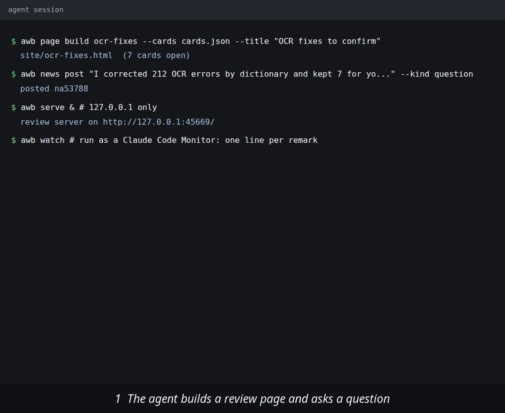
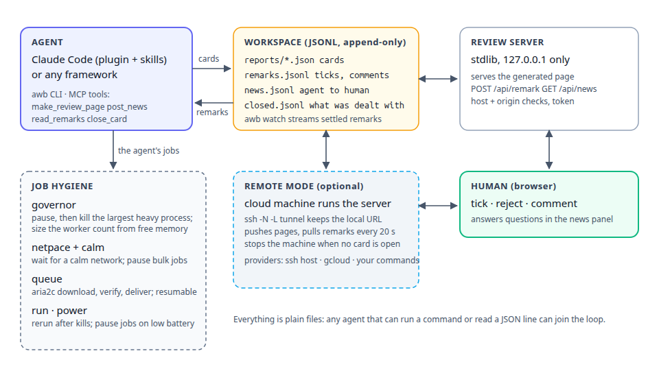
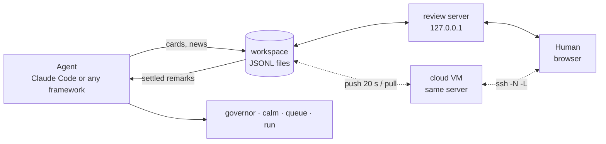

# agent-workbench

**Let an AI agent run a long job for weeks, and let a human steer it from a browser.** The agent posts cards and
news; you tick, reject and comment; the agent reads each remark the moment it settles and acts on it. A Claude Code
plugin and a plain CLI, standard library only.

[](https://github.com/kmbenjel/agent-workbench/actions/workflows/ci.yml)
[](https://pypi.org/project/agent-workbench/)
[](https://pypi.org/project/agent-workbench/)
[](LICENSE)



*A recording of the real thing: a real server, the real CLI, real clicks in headless Chrome. The agent proposes OCR
fixes on a public-domain novel, the reviewer approves six and rejects one with a reason, the agent receives each
remark, closes the cards (and is refused when it tries to close one on words nobody said), and posts the result.*

## Quickstart

```bash
uvx agent-workbench demo --serve          # or: pipx install agent-workbench
# open http://127.0.0.1:8765/ocr-fixes.html, tick a few cards, then in a second terminal:
uvx agent-workbench --root awb-demo watch --from-start --settle 3
```

The demo page is ready in about half a second (`awb demo` builds it, `awb serve` answers on `127.0.0.1`). A static
copy you can click through in any browser, no install, is in [`docs/demo/`](docs/demo/index.html) (ticks stay in your
browser).

In Claude Code: `/plugin install agent-workbench --marketplace kmbenjel/agent-workbench`, then ask for a review
(`/agent-workbench:review`) or let the `review-loop` skill take over. See [Claude Code plugin](#claude-code-plugin).

## Why agent-workbench? How it compares

Long agent jobs (cleaning a library, labelling a dataset, converting thousands of files, a media pipeline) fail in
two ways: the agent **guesses** where it should have asked, or the person is **asked in the terminal**, where the
answer is lost when the session scrolls. Annotation tools solve a neighbouring problem (a team labelling a dataset)
and ask you to run a server stack; hooks and permission prompts stop one tool call, not a review of a thousand.

agent-workbench is the missing small piece: **a review page the agent writes and a person ticks, with the answers
streamed back into the running agent session**, plus the plumbing a weeks-long job needs (remote serving, memory,
network, resumability).

| | agent-workbench | Label Studio | Argilla | Prodigy | LangSmith annotation queues | Claude Code hooks |
|---|---|---|---|---|---|---|
| Agent posts cards and reads remarks with one command or tool call | ✓ CLI + MCP | partial (REST API, SDK) | partial (Python SDK) | partial (Python database API) | partial (SDK) | ✗ (no review UI) |
| Remarks **pushed into the running agent session**, one line each | ✓ `awb watch` (Monitor) | partial (webhook to an HTTP endpoint you run) | partial (webhook to an endpoint you run) | ✗ not documented | ✗ not documented | partial (`asyncRewake`, `Monitor` tool, no review UI) |
| News and questions from the agent **on the page**, answered there | ✓ | ✗ not documented | ✗ not documented | ✗ not documented | ✗ not documented | ✗ |
| A close note must quote what the reviewer really said | ✓ | ✗ | ✗ | ✗ | ✗ | ✗ |
| Install with no server stack (no database, Docker, account) | ✓ 0.3 MB, 1 package | ✗ 810 MB, 158 packages | ✗ server needs Docker/Elasticsearch or a Hugging Face Space | partial (one wheel, paid licence key) | ✗ hosted service | ✓ built in |
| Review from a phone through your own machine: ssh tunnel to a cloud VM, auto-stop | ✓ | ✗ | ✗ | ✗ | ✗ | ✗ |
| Job hygiene: memory governor, network pacing, resumable download queue | ✓ | ✗ | ✗ | ✗ | ✗ | ✗ |
| Claude Code plugin and MCP tools | ✓ | ✗ | ✗ | ✗ | ✗ | n/a |
| Rich labelling UIs (spans, boxes, audio, ...) | ✗ (cards: text, images, tick, comment) | ✓ | ✓ | ✓ | partial (rubrics) | ✗ |

<sub>Checked 2026-11-13 against Label Studio 1.23.2 (PyPI, install guide, webhooks guide), Argilla 2.8.0 (PyPI,
quickstart, webhooks guide), Prodigy (install guide, database API page), LangSmith annotation queues (docs), and the
Claude Code hooks reference. "Not documented" means the page I read does not describe it, not that it cannot be built.
A "✗" in the last rows means the product does not offer it as a feature (any web app can be tunnelled by hand). Label
Studio and Argilla offer a lot this kit does not (many annotation types, teams, quality metrics); see below.</sub>

**What is different, with evidence**

1. **Built for the agent, not for annotators.** The reviewer's remark arrives in the agent's session as one line
   (`REMARK ocr-fixes line-7 verdict=reject «Keep the British spelling…»`) once they stop typing, resumes without
   loss after a restart, and the agent answers on the page. *Evidence:* the recording above; `tests/test_watch.py`.
2. **No invented approvals.** `awb close` refuses a note that does not quote words really on record for that card;
   an approved card stays hidden after a redo unless its content changed (then it comes back marked). *Evidence:* the
   refusal in the recording; `tests/test_store.py`, `tests/test_page.py`.
3. **Nothing to run but Python.** One wheel, no dependencies on Python 3.11+, a stdlib server that listens on
   `127.0.0.1` only. *Evidence:* `python bench/compare.py`, measured on a cloud VM:

   | tool (cold install) | disk | packages | time to first page | server RSS |
   |---|---|---|---|---|
   | agent-workbench 0.1.0 | 0.3 MB | 1 | 0.3 s (page already holds cards) | 25 MB |
   | Label Studio 1.23.2 | 810 MB | 158 | 33.0 s (empty UI, first start) | 392 MB |
   | Argilla 2.8.0 (client only) | 337 MB | 38 | n/a (server needs Docker/Elasticsearch or a Space) | n/a |

4. **Review from anywhere, from your own machine.** Build the page, serve it from a cloud VM that listens on its
   own loopback, reach it through an `ssh -N -L` unit, pull the remarks back every 20 s, and let the VM stop itself
   when no card is open. No open port, no static address, no account. *Evidence:* `awb remote`, `tests/test_remote.py`.
5. **The plumbing a multi-week job needs, in the same kit.** A memory governor that pauses (then, only if it must,
   kills) the largest heavy process before the kernel takes the desktop down; network pacing that waits for a calm
   network and pauses bulk transfers while someone is gaming; a resumable aria2c queue with staging caps; a rerun
   wrapper; a battery guard. *Evidence:* `tests/test_governor.py` runs the decision logic against fake processes.

**When to use something else.** If you need a team labelling thousands of items with span, box, audio or
time-series tools, inter-annotator agreement and review workflows, use Label Studio or Argilla: they are built for
that and this kit is not. If you want model-evaluation traces and datasets with built-in rubrics, LangSmith's queues
sit next to your traces. If you only need to approve or deny one tool call, Claude Code's permission prompts and
hooks are enough. agent-workbench is for the case in between: **one person steering one long agent job**.

## Features

- **Review pages**: a self-contained HTML page of cards (title, text, images, a "why I am unsure" line), each with
  Approve / Reject / a comment box that saves as you type. Progress bar, filters, dark mode, RTL languages, labels
  you can translate, works from a phone. Opened as a plain file it keeps your ticks in the browser.
- **News panel** at the top of the page: the agent posts updates and questions; questions get an answer box.
- **JSONL protocol** ([docs/protocol.md](docs/protocol.md)): `remarks.jsonl`, `news.jsonl`, `closed.jsonl`,
  append-only, one JSON object per line. Any language can write or read it.
- **`awb watch`**: settled remarks as lines (or JSON), with a saved position; a Claude Code Monitor takes it directly.
- **Stable cards**: ids are yours; rebuilding a page never renumbers and never loses a remark.
- **Remote mode**: ssh host, `gcloud`, or your own start/stop commands; tunnel unit; 20 s sync; auto-stop.
- **Job hygiene**: `governor`, `calm wait`, `netguard`, `queue`, `run`, `power`.
- **Plugin + MCP**: skills (`review-loop`, `remote-review`, `job-hygiene`), slash commands, and an MCP server with
  `post_news`, `read_remarks`, `make_review_page`, `close_card` (no dependencies).
- **Safe by default**: loopback only; a token is required to listen elsewhere; `Host`, `Origin` and content-type
  checks against DNS rebinding and cross-site posts; path-confined static files; bodies capped at 64 KB.

## How it works





The whole loop in six steps (the `review-loop` skill teaches an agent exactly this):

```bash
awb page build ocr --cards cards.jsonl --title "OCR fixes"     # 1. cards in, page out
awb news post "7 lines need your eye. British or modern spelling?" --kind question
awb serve &                                                      # 2. http://127.0.0.1:8765/ocr.html
awb watch                                                        # 3. run as a Claude Code Monitor
# REMARK ocr line-7 verdict=reject «Keep the British spelling…»  # 4. the agent receives it, acts, then
awb close ocr line-7 'kept British: «Keep the British spelling»' # 5. closes it (the quote must be on record)
awb news post "Applied 6 fixes" --kind done                      # 6. tells the reviewer on the page
```

## Remote review

```toml
# workbench.toml
[remote]
provider = "gcloud"            # or "ssh" (an always-on host) or "command" (your own start/stop)
instance = "review-box"
zone = "europe-west1-b"
```

```bash
awb remote up       # start the VM, push, serve, open the tunnel and the 20 s sync loop; prints the URL
awb remote down     # a last pull, then stop the VM and the tunnel (auto-stops by itself when no card is open)
```

The VM needs only `python3`, `rsync` and key-based ssh; the package is pushed to it. Its server binds the VM's own
loopback and requires a token generated for you.

## Job hygiene

| Command | What it does |
|---|---|
| `awb governor` | Pen (optional systemd slice) sized from free memory; worker count in a file your job reads; pauses the largest heavy process under pressure, kills only when critical, resumes one at a time when calm; never touches protected units |
| `awb calm wait 10 && ...` | Returns after the network has been quiet for 10 minutes (router and internet round trips) |
| `awb netguard -- CMD` | Runs a command, stopping it while the network is busy |
| `awb queue run q.tsv` | aria2c download, verify (size, magic, tail, your command), deliver (directory, rclone, your command); staging cap; `.done`/`.failed` state |
| `awb run --log job.log -- CMD` | Reruns a killed job once memory is back; gives up after N reruns without progress |
| `awb power` | Pauses jobs at a low battery, optionally sleeps, and checks the sleep really happened |

The governor, battery guard and calm checks read Linux `/proc`, `/sys` and `ping`.

## Claude Code plugin

```text
/plugin install agent-workbench --marketplace kmbenjel/agent-workbench
```

| Piece | Name |
|---|---|
| Skills | `review-loop`, `remote-review`, `job-hygiene` |
| Slash commands | `/agent-workbench:review`, `:watch`, `:news`, `:status` |
| MCP server | `post_news`, `read_remarks`, `make_review_page`, `close_card` (stdlib, started with `python3 -m agent_workbench mcp`) |

The plugin expects the `awb` command on `PATH` (`pipx install agent-workbench`). Plain CLI use needs no plugin: every
command has `--json` output where it matters, so any agent framework can drive it.

## Configuration

One optional `workbench.toml`; every key has a default and unknown keys are errors. `awb init` writes the commented
template ([examples/workbench.toml](examples/workbench.toml)).

## Design decisions

- **Files, not a database.** Append-only JSONL: you can `tail -f`, `grep`, diff and back it up; the "latest per card
  wins" rule makes concurrent writers safe without locks.
- **The agent pulls, the page never pushes.** A settle window (45 s) turns a half-typed sentence into one remark.
- **A tick holds until the card changes.** Each card has a revision fingerprint; a remark remembers the revision it
  judged. Redo the job and judged cards stay out of the way; change a card and it returns marked.
- **Closing is an act with a witness.** The note quotes the reviewer and the quote is checked against the record.
- **Least destructive first.** The governor pauses before it kills, and shrinks the worker count before either.
- **No hosted relay.** Remote review is your VM and your ssh key; the server never listens beyond loopback there.

## Roadmap

- PyPI release and a hosted static demo page.
- More card kinds: side-by-side diff, audio snippet, table row.
- Governor and calm checks for macOS and Windows.
- Outgoing webhooks and a Slack/ntfy notifier for new remarks.
- An MCP resource that streams remarks to clients that support subscriptions.

## Development

```bash
make install && make test      # 124 tests, 88 % line+branch coverage, about 5 s
make demo                      # the demo, served
make media                     # regenerate the recording (Chrome + ffmpeg + ImageMagick; run it on a VM)
python bench/compare.py        # the install/footprint comparison (run it on a VM)
```

See [CONTRIBUTING.md](CONTRIBUTING.md) and [CHANGELOG.md](CHANGELOG.md). Arabic documentation:
[warraq.benjelloun.dev/agent-workbench](https://warraq.benjelloun.dev/agent-workbench/) (source in
[`docs/ar/`](docs/ar/index.md)). Part of **[Warraq](https://warraq.benjelloun.dev)** (الورّاق), open tools for Arabic libraries.

## Licence

MIT. If you use it in research, cite it with [CITATION.cff](CITATION.cff).
