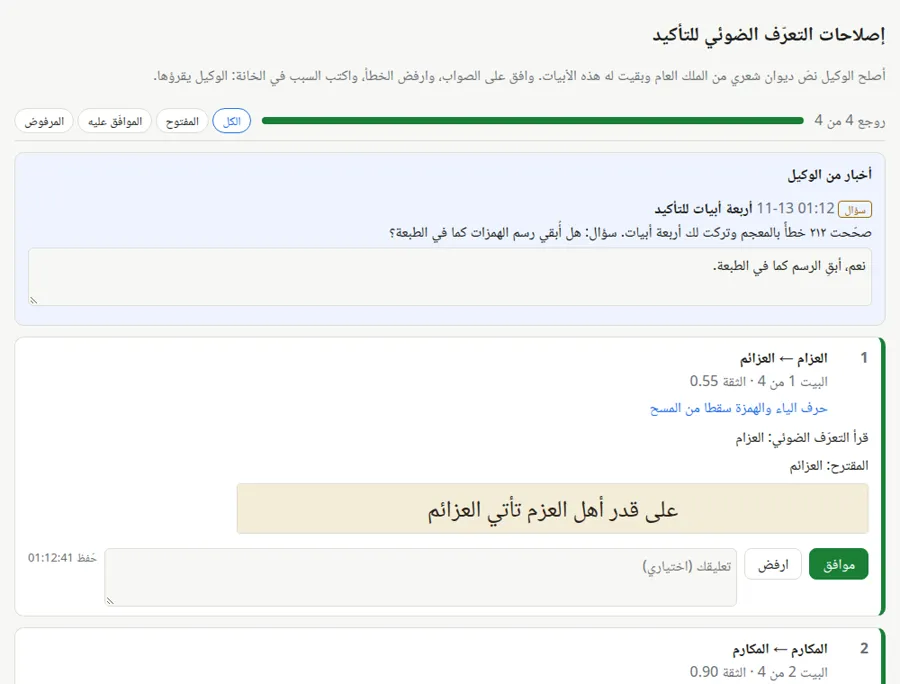
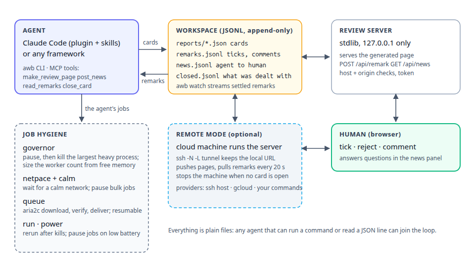

# agent-workbench: مراجعة بشرية لأعمال الوكلاء الطويلة

حين يعمل وكيل ذكي (مثل Claude Code) على مهمة تمتد أيامًا وأسابيع، كتنظيف مكتبة من آلاف الكتب أو تدقيق نتائج
التعرّف الضوئي أو معالجة ملفات صوتية، يقع أحد خطأين: إما أن **يخمّن** حيث كان ينبغي أن يسأل، وإما أن **يسألك في
الطرفية** فيضيع جوابك حين يمرّ السؤال ويُطوى النص.

**agent-workbench** يحلّ هذا بصفحة مراجعة في المتصفح:

1. يكتب الوكيل **بطاقات** (عنوان، اقتراح، سبب الشك، صورة).
2. تفتح الصفحة، فتضغط «موافق» أو «ارفض» أو تكتب ملاحظة.
3. يصل كل جواب إلى جلسة الوكيل **سطرًا واحدًا** حين تتوقف عن الكتابة، فيعمل به ثم يغلق البطاقة.
4. تقرأ أنت في أعلى الصفحة **أخبار الوكيل وأسئلته** وتجيب عنها هناك.

## لمن هو؟

- من يشرف على وكيل في مهمة طويلة ويريد مراجعة نتائجها بعينه لا بالتخمين.
- المكتبات والمشاريع التي تعالج كتبًا وصورًا وملفات كثيرة، وتحتاج حكمًا بشريًا في الحالات المشكوك فيها.
- كل إطار وكلاء يستطيع تشغيل أمر في الطرفية أو قراءة سطر JSON، لا Claude Code وحده.

## ماذا في العدّة؟

| الجزء | وظيفته |
|---|---|
| صفحات المراجعة | بطاقات بأزرار موافقة ورفض وخانة ملاحظة تُحفظ أثناء الكتابة، وتدعم العربية من اليمين إلى اليسار |
| لوحة الأخبار | يخبرك الوكيل بما أنجز ويسألك، وتجيب في الصفحة نفسها |
| `awb watch` | يبثّ الملاحظات إلى الوكيل سطرًا سطرًا (يصلح مراقِبًا في Claude Code) |
| الوضع البعيد | يخدم الصفحة من حاسوب سحابي عبر نفق `ssh`، ويطفئه إذا لم تبقَ بطاقة مفتوحة |
| صحّة المهمة | حارس للذاكرة، وتهدئة للشبكة، وطابور تنزيل يُستأنف، وإعادة تشغيل بعد الإيقاف |
| إضافة Claude Code | مهارات وأوامر وخادم MCP، وأمر `awb` لأي إطار آخر |

لا يحتاج إلا إلى بايثون: لا قاعدة بيانات ولا حاويات ولا حسابًا. وحجمه نحو 0.3 ميغابايت.

## كيف يعمل؟

كل شيء ملفات نصية من نوع JSONL (ملاحظاتك، وأخبار الوكيل، وما أغلقه الوكيل)، فيستطيع أي برنامج قراءتها
وكتابتها. اقرأ [البدء السريع](quickstart.md) لتجرّبه في أقل من دقيقة، و[ما الذي يميّزه؟](why.md) لمقارنته بالأدوات
الأخرى.

!!! tip "مع بقية أدوات وراق"
    إذا كانت أداة أخرى من العائلة تنتج أوراق مراجعة (كقصّ صفحات الكتب في [safha](/safha/))، فبطاقاتها تصلح مادةً لهذه
    الصفحات، لأن البطاقة سطر JSON فيه عنوان ونص وصور.
