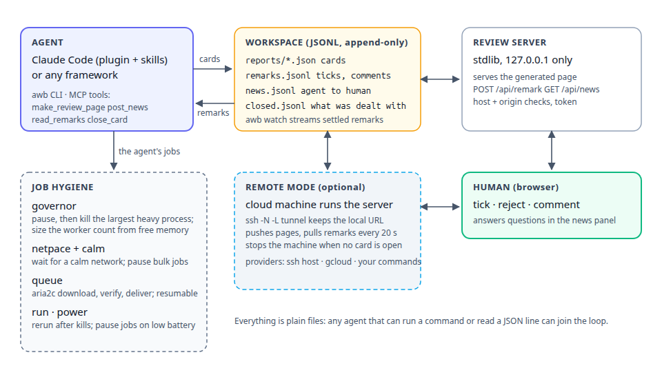

# Architecture

| Module | Responsibility |
|---|---|
| `store.py` | The JSONL protocol, card revisions, the strict close rule |
| `page.py` + `templates/` | Cards to one self-contained HTML page (no external assets) |
| `server.py` | Stdlib `ThreadingHTTPServer`: static pages, `/api/remark`, `/api/remarks`, `/api/news`, `/api/status` |
| `watch.py` | Settle window, saved position, line format |
| `review.py` | The agent's side: unhandled remarks, close, status |
| `remote.py` | Providers (ssh, gcloud, command), transport (rsync + ssh), units (systemd or detached processes), controller |
| `governor.py` | Memory guard; `Governor.step()` is pure given a `System` |
| `netpace.py`, `calm.py` | Rate controller, leaky bucket, calm detection, pause gate |
| `queue.py` | Download, verify, deliver with staging caps and resume state |
| `resumable.py`, `power.py` | Rerun after kills; battery guard |
| `mcp_server.py` | MCP over stdio (JSON-RPC 2.0), four tools |
| `cli.py` | The `awb` command |

## Why it is testable

Anything with a decision in it receives its inputs: the governor a `System` (free memory, pressure, processes,
signals), the watcher a clock, the remote controller a provider, a transport and a units manager, the queue a fetch
and a deliver function, the power guard a battery directory and a process finder. Tests use fakes; a few tests also
run against real processes (`sleep`, a real HTTP server on an ephemeral port, the MCP server on a real pipe).

## Security model

- The server binds `127.0.0.1`; another host needs `[server] token` and is refused without it.
- `Host` must be loopback (or listed in `allowed_hosts`): blocks DNS-rebinding. POSTs must be `application/json`
  and any `Origin` must equal `Host`: blocks cross-site form posts. Bodies are capped at 64 KB.
- Static files are served from the site directory only, symlink-resolved.
- Remote: the VM server binds its loopback; the token travels over ssh stdin into a 0600 file, never on a command
  line; the local tunnel is an ssh port forward to loopback.
- Queue targets must be relative paths without `..`.
