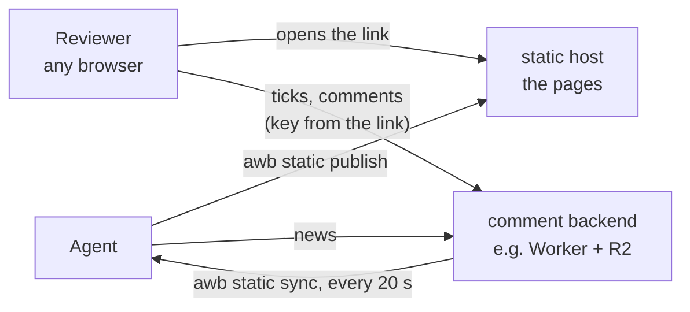

# Guide: static review

Publish the review page on any static host and let a small backend carry the remarks. The reviewer opens an
ordinary https link on a phone or any computer, and nothing of yours stays up for the review: no server, no
tunnel, no VM.



## Set up once

1. **A comment backend.** [`examples/cloudflare-worker/`](../../examples/cloudflare-worker/README.md) is one for
   Cloudflare (a Worker and an R2 bucket, deployed with four wrangler commands). It holds two keys: the reviewer's and the
   agent's. Anything that answers the four requests of [the protocol](../protocol.md#the-http-api) will do.
2. **A static host** for the site directory: GitHub Pages, Cloudflare Pages, a bucket with a website endpoint,
   a directory on a web server.
3. **`workbench.toml`:**

   ```toml
   [static]
   api = "https://awb-comments.example.workers.dev"   # the backend
   page_url = "https://reviews.example.org"           # where the site directory ends up
   publish_cmd = "rsync -a {site}/ host:/var/www/reviews/"
   ```

   The keys come from the environment, so they never land in a repository: `AWB_REVIEW_KEY` (reviewer) and
   `AWB_STATIC_TOKEN` (agent).

## Use

```bash
awb page build ocr --cards cards.jsonl     # the page now talks to the backend instead of awb serve
awb static publish                         # runs publish_cmd on the site directory
awb static url ocr                         # https://reviews.example.org/ocr.html#k=<reviewer key>
awb static loop &                          # every sync_seconds: pull remarks, push the news panel
awb watch                                  # unchanged: one line per settled remark
```

`awb static sync` does one round. Pulled remarks are appended to `remarks.jsonl`, so `awb watch`, `awb remarks`,
`awb close` and the hiding of approved cards work exactly as with the local server. After `awb page build`, run
`awb static publish` again; news needs no publish, the loop pushes it.

## What the reviewer sees

- The link carries the key after `#k=`; the browser remembers it for that site, so the index and the other pages
  open without it afterwards.
- A link without a valid key says so on the page and keeps ticks in the browser; so does a backend that does not
  answer. A save that was refused is shown as "not saved", never as saved.

## Limits and safety

- The key guards the remarks and the news. The pages are as public as their host makes them: for private material
  use a host with access control, or [remote review](remote-review.md), where nothing is published.
- The link is a password. Send it the way you would send one, and replace the reviewer key to withdraw it.
- Inside another page's frame the review page does not use the key (a static host may allow framing), so a click
  collected there reaches no one.
- The backend keeps the latest remark per card, which is all the protocol needs.
